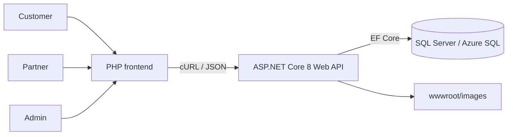
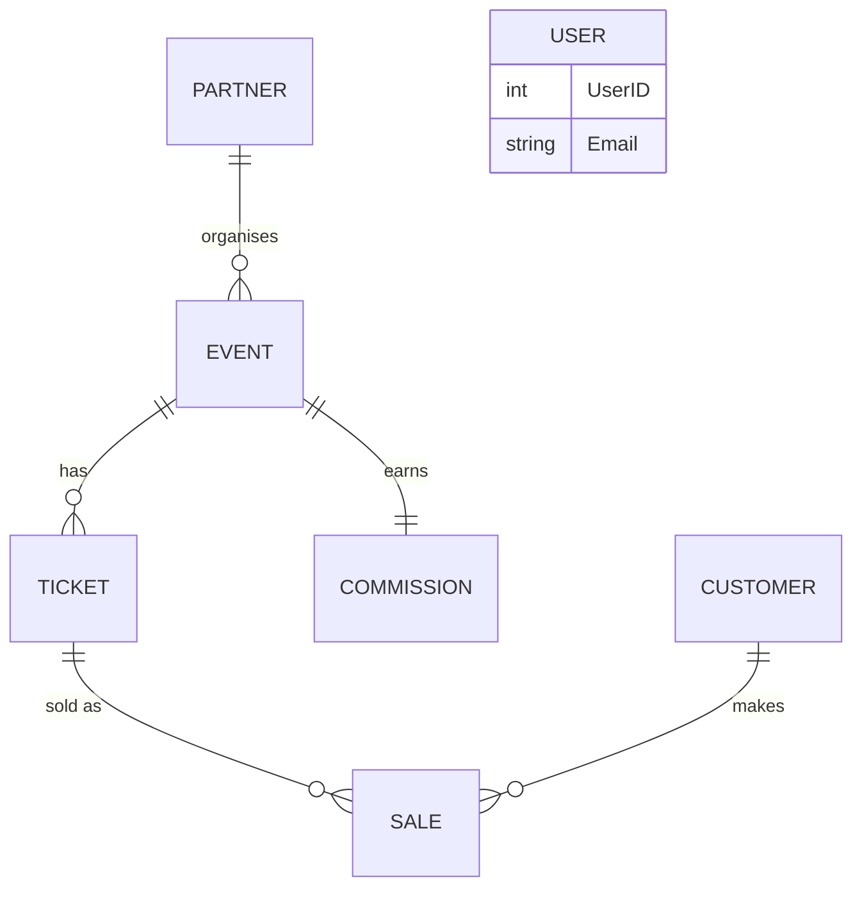

# Debra Events: Event Management & Ticketing System

A full-stack event ticketing platform. Event partners list their events, customers browse and book tickets, and an admin manages partners, events, sales and commissions. The backend is an ASP.NET Core 8 Web API using Entity Framework Core and SQL Server. The frontend is a PHP web app that calls the API over HTTP with cURL. The backend is containerised with Docker and has been deployed to Azure.

## Features

### Customers
- Browse upcoming events on the home page
- View event details with the available ticket types, prices and remaining seats
- Book tickets by entering their details, and get a printable ticket receipt

### Partners (event organisers)
- Register for a partner account; only accounts the admin has activated can sign in
- View their own events and sales in a partner dashboard

### Admin
- Dashboard with a sales chart (Chart.js)
- Create events with an image, ticket types (price and quantity) and a commission rate
- View and manage events, partners and sales
- Add partners, and activate or deactivate their accounts

### Backend
- RESTful API covering 7 resources, with Swagger UI in development
- Repository pattern behind interfaces, registered through dependency injection
- AutoMapper for mapping between entities and DTOs
- EF Core code-first migrations on SQL Server
- Calculated fields: remaining tickets (`Quantity - Sold`) and commission amount (`CommissionRate × TotalSales`)
- Event image upload, served as static files from `wwwroot/images`
- Optional sample-data seeding

## Architecture



## Tech stack

| Layer | Tools |
|---|---|
| Backend | ASP.NET Core 8 Web API, C# |
| Data | Entity Framework Core 8, SQL Server |
| Mapping & docs | AutoMapper, Swashbuckle (Swagger) |
| Frontend | PHP, cURL, HTML, CSS, JavaScript, Chart.js, Font Awesome |
| DevOps | Docker (multi-stage build), Azure |

## Project structure

```
eventMgtSys/
├── backend/                  # ASP.NET Core Web API (project: debraApp)
│   ├── Controllers/          # Event, Ticket, Partner, Customer, Sale, Commission, User
│   ├── Models/               # EF Core entities
│   ├── Dto/                  # Request/response DTOs
│   ├── Interfaces/           # Repository contracts
│   ├── Repository/           # Repository implementations
│   ├── DAL/DataContext.cs    # DbContext and relationships
│   ├── Helper/MappingProfiles.cs
│   ├── Migrations/
│   ├── Seed.cs               # Sample data
│   ├── Program.cs
│   └── Dockerfile
└── frontend/                 # PHP web app
    ├── index.php             # Public event listing
    ├── login.php, registration.php, logout.php
    ├── client/               # Event details, booking, payment, ticket receipt
    ├── partner/              # Partner dashboard
    ├── admin/                # Admin dashboard, events, partners, sales
    └── assets/               # CSS and JS
```

## Getting started

### Prerequisites

- [.NET 8 SDK](https://dotnet.microsoft.com/download/dotnet/8.0)
- SQL Server (LocalDB, Docker, or Azure SQL)
- PHP 8+ with the `curl` extension enabled
- EF Core CLI: `dotnet tool install --global dotnet-ef`

### 1. Configure the database connection

Set the connection string with .NET user secrets, so it stays out of source control:

```bash
cd backend
dotnet user-secrets set "ConnectionStrings:DefaultConnection" "Server=localhost;Database=DebraEvents;User Id=sa;Password=<your-password>;TrustServerCertificate=True"
```

Or set it as an environment variable:

```bash
export ConnectionStrings__DefaultConnection="Server=...;Database=DebraEvents;..."
```

### 2. Create the database

```bash
cd backend
dotnet ef database update
```

### 3. (Optional) Seed sample data

```bash
dotnet run seeddata
```

This adds sample partners, events, tickets and an admin user, but only to an empty database.

### 4. Run the API

```bash
dotnet run --launch-profile https
```

The API runs at `https://localhost:7040`, with Swagger UI at `https://localhost:7040/swagger`.

### 5. Run the frontend

```bash
php -S localhost:8080 -t frontend
```

Open http://localhost:8080. The frontend expects the API at `https://localhost:7040`.

### Running the API in Docker

```bash
docker build -t debra-api ./backend
docker run -p 8080:8080 \
  -e ConnectionStrings__DefaultConnection="Server=...;Database=DebraEvents;..." \
  debra-api
```

## API reference

All routes are prefixed with `/api`.

| Resource | Endpoints |
|---|---|
| **Event** | `GET /Event`, `GET /Event/{id}`, `GET /Event/partner/{partnerID}`, `GET /Event/eventID/{eventName}`, `GET /Event/ticket/{eventID}`, `GET /Event/lastEventID`, `POST /Event` (form data), `POST /Event/upload` (image), `PUT /Event/{id}`, `DELETE /Event/{id}` |
| **Ticket** | `GET /Ticket`, `GET /Ticket/{id}`, `POST /Ticket`, `PUT /Ticket/{id}`, `DELETE /Ticket/{id}` |
| **Partner** | `GET /Partner`, `GET /Partner/{id}`, `GET /Partner/email/{email}`, `POST /Partner`, `POST /Partner/checkpassword`, `PUT /Partner/{id}`, `PUT /Partner/toggleStatus/{id}`, `DELETE /Partner/{id}` |
| **Customer** | `GET /Customer`, `GET /Customer/{id}`, `GET /Customer/lastInserted`, `POST /Customer`, `PUT /Customer/{id}`, `DELETE /Customer/{id}` |
| **Sale** | `GET /Sale`, `GET /Sale/{id}`, `GET /Sale/customer/{customerID}`, `POST /Sale`, `PUT /Sale/{id}`, `DELETE /Sale/{id}` |
| **Commission** | `GET /Commission`, `GET /Commission/{id}`, `GET /Commission/partner/{partnerID}`, `POST /Commission`, `PUT /Commission/{id}`, `DELETE /Commission/{id}` |
| **User** (admin) | `GET /User/{email}`, `POST /User/checkpassword` |

## Data model



- **Partner**: name, contact info, address, email, status (`Active` / inactive), registered date
- **Event**: name, description, date, time, location, type, image, owning partner
- **Ticket**: type, price, quantity, sold, remaining (calculated)
- **Customer**: name, email, phone number, NIC
- **Sale**: ticket, customer, sale date, ticket number
- **Commission**: one per event, with rate, total sales and amount (calculated)
- **User**: admin accounts

## Roadmap

- [ ] Hash passwords (for example with BCrypt or ASP.NET Core Identity) instead of comparing them in plain text
- [ ] Token-based auth (JWT) on API endpoints
- [ ] Move the API base URL in the frontend into one config value instead of hard-coding it in each page
- [ ] Turn SSL verification back on in the frontend's cURL calls for production
- [ ] Store event images in cloud storage (such as Azure Blob Storage) instead of the container's filesystem
- [ ] Integrate a real payment provider

## Author

**Ashane Arangalla**: [github.com/ashanearangalla](https://github.com/ashanearangalla)
